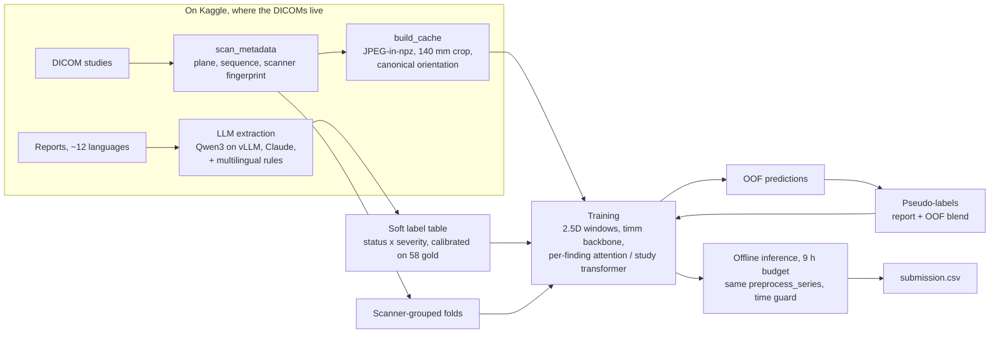

# RSNA Knee MRI: weak labels from multilingual reports + 2.5D study models

End-to-end toolkit for the Kaggle **RSNA Knee Abnormality Detection** (2026) challenge: robust DICOM ingestion,
LLM-extracted soft labels from free-text radiology reports in a dozen languages, 2.5D study-level models,
and a scripted Kaggle + Colab compute workflow that fits inside a 9-hour offline notebook.

[](pyproject.toml)
[](https://www.kaggle.com/competitions/rsna-knee-abnormality-detection)
[](LICENSE)

**Final leaderboard: 3502 / 6300 teams.** Best public-LB score from this project's own models: 0.933.
Full numbers and an honest account of what did and did not transfer to the test set are in [Results](#results).

## Overview

| | |
|---|---|
| Input | One knee MRI study: 3–14 DICOM series (sagittal / coronal / axial; PD / T2 / T1, with and without fat suppression), 11–320 slices per series |
| Output | 12 probabilities per study: ACL, MCL, medial / lateral meniscus, medial / lateral / patellofemoral OA, effusion, synovitis, Baker's cyst, bone contusion, fracture |
| Metric | Macro ROC-AUC over the 12 findings (rare findings weigh as much as common ones) |
| Train data | ~4,400 studies (819k DICOM files, 570 GB). Only **58** studies carry expert labels; the rest have only the free-text report, in ~12 languages |
| Test data | Hidden, ~1,300 studies from 16–19 sites, expert-labelled, **no reports** |
| Constraints | Code competition: Kaggle notebook, ≤ 9 h wall clock, no internet, Kaggle GPU (T4×2 / P100) |

The core difficulty is supervision, not architecture: training labels have to be read out of reports, while the test
set is labelled by experts who apply their own definitions (for example, "trace effusion" is not a positive).

## Approach



**DICOM and preprocessing** (`rsna_knee/dicom.py`, `series_select.py`, `preprocess.py`)
- Handles all four transfer syntaxes in the data (incl. JPEG Lossless and JPEG 2000), multi-frame, `MONOCHROME1`,
  mixed matrix sizes and dual-echo series; never crashes on a bad file.
- Slices are ordered by projection onto the slice normal in patient (LPS) coordinates, not by file name or
  `InstanceNumber` (they disagree in about a third of series).
- Plane comes from `ImageOrientationPatient`; sequence type from `SeriesDescription` (multilingual abbreviations) with a
  TE/TR/TI physics fallback. A 140 mm crop around the joint plus right-to-left mirroring gives every knee one
  canonical orientation.
- One function, `preprocess_series`, produces pixels for both the training cache and the offline inference notebook,
  so the train and test paths are identical by construction.

**Weak labels from reports** (`rsna_knee/reports/`)
- A structured schema per finding: `status` (present / absent / equivocal / not_mentioned), `severity`, `detail`
  (subtype) and a verbatim `evidence` quote, plus language, laterality and prior surgery. Thresholds can be changed
  later without re-running the LLM.
- Backends: Claude (structured outputs, prompt caching, Message Batches API) and any OpenAI-compatible endpoint. The
  production run used **Qwen3-14B-AWQ served by vLLM inside a Kaggle kernel** (2×T4), so report text never left
  Kaggle. A 13-language regex extractor (`rules.py`) is a cross-check and fallback.
- `labels.py` maps extractions to soft targets and per-sample loss weights, and calibrates per-label thresholds on the
  58 expert studies with an over-fitting guard. `pseudo.py` blends report targets with out-of-fold image predictions.

**Models and training** (`rsna_knee/models/`, `rsna_knee/train.py`)
- Slice encoder: any `timm` backbone over 2.5D windows (3 adjacent slices as RGB). Backbones used in submitted or
  ablated runs: EfficientNetV2-S, ConvNeXt-Nano, CoAtNet-2, ResNet-34d. A frozen-DINOv2-feature path trains only the
  aggregator for fast iteration.
- Aggregators: a hierarchical study transformer (series transformer, study transformer, 12 learned label queries
  cross-attending to all slice tokens), a per-finding attention-MIL head over a bag of windows from all series, and a
  mean + max pooling head.
- AdamW with separate backbone / head learning rates, cosine schedule, AMP, EMA, top-k checkpoint weight averaging,
  a sampler that boosts rare positives, and resumable checkpoints for preemptible sessions.
- Validation views logged every epoch: held-out scanner-grouped fold against report labels, the subset with
  confident report labels, and the 58 expert-labelled studies (never trained on).

**Inference** (`rsna_knee/infer.py`, `kaggle/kernels/infer_submit.py`): fold / seed ensemble, DICOM decoding in
DataLoader workers in parallel with the GPU, and a time-budget guard that first drops TTA and then ensemble members
if the projected run time exceeds the limit. A study with no readable series gets the training prior instead of
crashing the run.

## Results

Metric definitions: **gold** = macro AUC on the 58 expert-labelled training studies, held out from training.
**Confident** = macro AUC on a held-out scanner-grouped fold against report labels with confident targets
(≤ 0.15 or ≥ 0.85). **Public LB** = Kaggle public leaderboard. All numbers come from the run logs and notes kept
during the competition; nothing here is re-estimated.

### Leaderboard submissions

| Submission | Validation | Public LB |
|---|---|---|
| Round 1: EfficientNetV2-S 384 px + study transformer, rule-based labels | weak-label fold AUC 0.69 / 0.81 | 0.750 |
| 3× ConvNeXt-Nano, report-label blend | gold 0.913 | 0.926 |
| 3× ConvNeXt-Nano, OOF pseudo-labels | gold 0.915 | 0.927 |
| 6× ConvNeXt-Nano, per-finding attention head | gold 0.917 | 0.928 |
| 6× ConvNeXt-Nano + label mixing (synovitis ← effusion, fracture ← contusion) | gold 0.920 | 0.929 |
| 4 models (2× ConvNeXt-Nano, 2× ResNet-34d), mean + max pooling head, + label mixing | gold 0.897–0.920 per model | 0.929 |
| 2× CoAtNet-2 224 px | gold 0.908 / 0.913 | 0.930 |
| **2× ConvNeXt-Nano, long schedule** (20 epochs, 48 windows, no dropout / geometric aug) | gold 0.911 / 0.906 | **0.933** |
| Reference: fork of a public ensemble notebook (not this project's models) | | 0.939 |
| Same fork + this project's 4 EfficientNetV2-S models (runs r4, r5) rank-blended at weight 0.15 | confident 0.89–0.91 per model | 0.939 |
| **Final leaderboard (competition closed 2026-10-22)** | | **rank 3502 / 6300** |

### Label quality (macro AUC of the label table against the 58 expert studies)

| Labels | vs. gold |
|---|---|
| Own Qwen3-14B extraction, raw mapping ([`kaggle_out/extract/gold_agreement.csv`](kaggle_out/extract/gold_agreement.csv)) | 0.827 |
| Same, per-label calibrated mapping | 0.850 |
| Public LLM label tables shared on the forum | 0.870 / 0.893 |
| Report labels blended 50/50 with out-of-fold image predictions | ~0.92 |

Per finding, the raw extraction is strong where reports are explicit (ACL 0.94, medial meniscus 0.92, Baker's cyst
0.91) and weak where experts and reporting radiologists disagree on thresholds (effusion 0.65, synovitis 0.74,
patellofemoral OA 0.77). Counting effusion as positive only from "moderate" severity raised effusion from 0.65 to 0.79.

### Controlled ablations

One change at a time. Unless a row says otherwise: ConvNeXt-Nano, 288 px, per-finding attention head, 2 seeds,
scored on a held-out fold (confident) and on the 58 gold studies. Baseline: confident 0.950, gold 0.910.

| Change | Confident / gold | Verdict |
|---|---|---|
| 224 px with 48 / 96 windows (more slice coverage) | 0.949 / 0.906 | no gain |
| Pairwise AUC loss (public-notebook settings) | 0.949 / 0.908 | no gain |
| Warm start from an earlier own model instead of ImageNet | confident +0.006, gold +0.000 / +0.002 | marginal |
| 58 expert studies added to training (gold-CV over 58) | gold 0.907 vs 0.912 | worse, dropped |
| Mean + max pooling instead of attention | gold 0.920 / 0.914 vs 0.917 / 0.912 / 0.910 | equal |
| Spatial attention head on EfficientNetV2-S (run r5 vs r4) | weak-label fold AUC −0.02 to 0 | dropped |
| Smart crop on a wider 180 mm cache | public LB 0.930 vs 0.933 | no gain |

Engineering checks: the live DICOM inference path and the training cache path agree (208 training studies:
0 unreadable, per-model gold AUC difference −0.001 on average, prediction correlation 0.995–0.998).
Repeating an identical run moved the held-out score by about 0.01, which sets the noise floor for every row above.

## What worked, what didn't

**Worked**
- Treating label quality as the main lever: severity-aware mapping, calibration on the expert set, blending several
  label sources, and out-of-fold pseudo-labels raised label agreement with experts from 0.83 to about 0.92.
- A deterministic, defensive DICOM path shared by training and inference: no train / serve skew, no crashes on
  unusual series.
- A longer, less regularised schedule: the best own result (0.933 public LB, +0.006 over comparable 2-model
  ensembles).
- Scripted compute: self-contained Kaggle kernels driven from a local queue, plus Colab A100 workers pulling from a
  shared job queue, so ablations and submissions ran unattended overnight on free and low-cost GPUs.

**Didn't**
- Gains on the 58 expert studies did not transfer to the leaderboard. Gold rose by 0.012 while the public LB rose by
  0.002–0.003, and the long-schedule model had the lowest gold score and the best LB score. Fifty-eight studies are
  too few to select models on.
- Better labels stopped paying off past ~0.89 agreement: pseudo-labels gave +0.0024 on gold and +0.001 on the LB.
- Architecture and recipe changes (spatial head, mean + max pooling vs attention, warm start, pairwise loss, wider
  slice coverage, smart crop) produced no gain beyond the run-to-run noise.
- Own models plateaued at 0.926–0.933 public LB, below the public ensemble at 0.939. Our gold-to-LB offset was
  +0.011, against roughly +0.02 reported by top teams. The leading hypothesis in the notes is site shift between
  training hospitals and the test set; one concrete suspect is the right-to-left mirroring heuristic, which leaves
  the knee side undetermined for 3.2 % of training studies (up to 42 % in one scanner group) and disagrees with the
  DICOM laterality tag in 1.3 %.

## Repository structure

```
rsna_knee/            core package
  dicom.py            DICOM loading, slice ordering, plane / sequence inference, preprocess_series
  series_select.py    which series of a study feed the model
  preprocess.py       JPEG-in-npz cache builder
  cv.py               scanner-grouped, label-stratified folds
  data/               study dataset (2.5D windows over all series), series-consistent augmentation
  models/             timm backbone factory, study transformer / attention-MIL / mean-max heads, losses
  reports/            extraction schema, prompts, LLM backends, multilingual rules, label mapping + calibration
  pseudo.py           out-of-fold pseudo-label blending
  train.py            training loop (python -m rsna_knee.train)
  infer.py            offline inference with a time-budget guard
  kaggle_io.py        resumable download of multi-GB Kaggle kernel outputs
scripts/              CLI steps: scan, cache, extract labels, label table, folds, features, pseudo-labels, predict
configs/              training configs: base, frozen-feature path, v2-v4 recipes and ablations
kaggle/               kernel launcher and kernel bodies, offline inference notebook, blend builder, packaging
colab/                Colab A100 training: notebook, train wrapper, job-queue worker, pseudo-label pipeline
tests/                49 tests on synthetic DICOMs, including an end-to-end DICOM -> submission run
kaggle_out/           per-epoch metric histories and configs of selected Kaggle runs, extraction-vs-gold table
labels/               extraction guide and calibrated mapping summaries (no per-study labels)
docs/RESEARCH.md      forum, public-notebook and literature review with action plan (in Russian)
PLAN.md               original architecture and schedule (in Russian)
```

Competition data, per-study label tables, folds, caches, OOF predictions, submissions and model weights are not part
of this repository (Kaggle competition data licence). The scripts below rebuild them from the competition data.

## Quickstart

```bash
git clone https://github.com/kholkink/rsna-knee-mri.git && cd rsna-knee-mri
uv venv --python 3.12 .venv && source .venv/bin/activate
uv pip install --index-url https://download.pytorch.org/whl/cpu torch torchvision   # or a CUDA build
uv pip install -e ".[llm,dev]"
pytest -q                                     # 49 tests on synthetic DICOMs, CPU, under a minute
```

### Training pipeline

Accept the competition rules on Kaggle first. Only the CSVs are needed locally; the 570 GB of DICOM stay on Kaggle.

```bash
kaggle competitions download -c rsna-knee-abnormality-detection -f train.csv -p data/

# 1-2. metadata scan + JPEG cache (on Kaggle via kaggle/launch.py, or on any machine that has the images)
python scripts/scan_metadata.py --image-root $IMG/train_images --series-csv data/train_series.csv --out data/meta_train.parquet
python scripts/build_cache.py --meta data/meta_train.parquet --out cache --size 384 --shard 0/1

# 3. reports -> structured findings (Claude batches, or a local OpenAI-compatible model) + rule cross-check
python scripts/extract_labels.py --train-csv data/train.csv --out labels/extractions.jsonl --backend anthropic --batch

# 4. soft labels, agreement with the 58 gold studies, calibration
#    (--calibrate writes the fitted mapping to --map-config; labels/label_map_qwen_cal.yaml is a committed example)
python scripts/make_label_table.py --train-csv data/train.csv --extractions labels/extractions.jsonl \
    --rules labels/rules.parquet --out labels/label_table.parquet --calibrate --map-config labels/label_map.yaml

# 5. scanner-grouped folds
python scripts/make_folds.py --label-table labels/label_table.parquet --meta data/meta_train.parquet --out labels/folds.parquet

# 6a. fast path: frozen DINOv2 features + study transformer (minutes per fold)
python scripts/extract_features.py --cache-index cache/cache_index.parquet --out features/dinov2b
python -m rsna_knee.train --config configs/feat_dinov2.yaml --fold 0

# 6b. end-to-end 2.5D training; any config key can be overridden on the command line
python -m rsna_knee.train --config configs/base.yaml --fold 0 optim.epochs=12 model.backbone=convnext_nano.in12k_ft_in1k

# 7. inference -> submission.csv (locally on a test-like folder, or inside the Kaggle notebook)
python scripts/predict.py --comp-root /kaggle/input/rsna-knee-abnormality-detection --runs runs/effv2s_384/fold*
```

## Compute workflow: Kaggle + Colab

The DICOMs exist only on Kaggle, so heavy steps run there as **self-contained script kernels**: `kaggle/launch.py`
embeds a base64 tar of the repository into a single script together with JSON parameters, so a push is atomic and no
code dataset has to be versioned.

```bash
python kaggle/launch.py whoami
python kaggle/launch.py push cache --shards 3        # CPU: header scan + JPEG cache tar per shard (no GPU quota)
python kaggle/launch.py push extract                 # GPU T4x2: vLLM + Qwen3 inside Kaggle, reports never leave Kaggle
python kaggle/launch.py status
python kaggle/launch.py pull cache --out kaggle_out --pattern '\.(parquet|json)$'     # skip the multi-GB tars
python kaggle/launch.py push train --name effv2s --param 'folds=[0,1]' \
    --kernel-source USER/rsna-knee-cache-0of3 --kernel-source USER/rsna-knee-cache-1of3 \
    --kernel-source USER/rsna-knee-cache-2of3 --kernel-source USER/rsna-knee-extract
python kaggle/launch.py run-local cache --comp-root /path/to/fake_comp --work /tmp/w   # dry run of any kernel
```

Authentication: the Kaggle CLI reads `KAGGLE_API_TOKEN`, then `~/.kaggle/access_token`, then `~/.kaggle/kaggle.json`.
LLM backends read `ANTHROPIC_API_KEY`, `OPENAI_API_KEY` or `DEEPSEEK_API_KEY` from the environment or a local `.env`
(never committed).

Longer training runs went to **Google Colab A100s** ([`colab/rsna_knee_colab.ipynb`](colab/rsna_knee_colab.ipynb)).
`colab/colab_train.py` pulls the Kaggle-built cache (~19 GB), trains with checkpoints on Google Drive so a
disconnected session resumes from the last epoch, and publishes finished runs as a private Kaggle dataset that the
offline inference kernel mounts. `colab/worker.py` + `colab/jobs.py` turn Colab sessions into queue workers: jobs
live in a private Kaggle dataset, so experiments are added or reordered without editing the notebook.
`colab/pipeline.py` chains teacher OOF models, pseudo-label generation and production seeds in one resumable command.

## License

[MIT](LICENSE) for the code in this repository. Competition data belongs to RSNA / Kaggle and is subject to the
competition rules; it is not included here.
